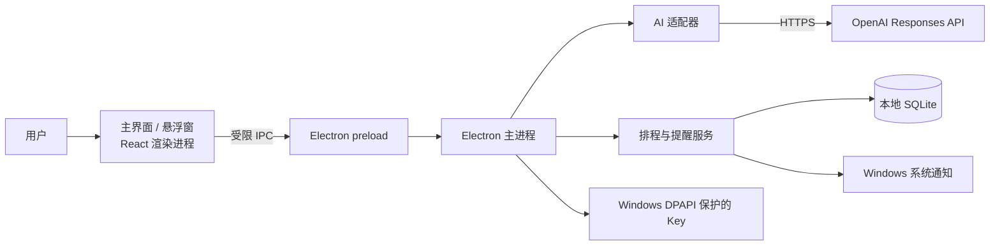
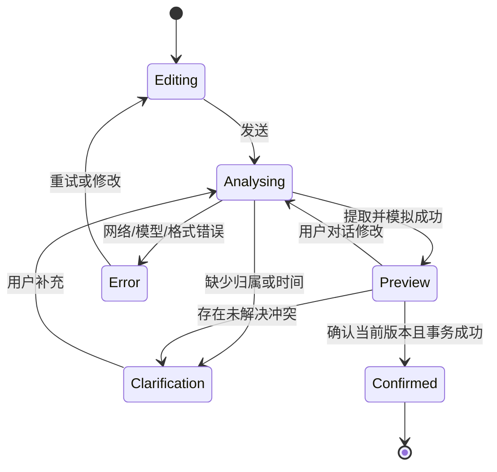

# Yuiee 第一版架构设计（评审稿）

- 日期：2026-10-13
- 状态：待评审
- 输入基线：[requirements-v0.2.md](./requirements-v0.2.md)
- 目标平台：Windows 10/11，单用户本地应用

## 1. 架构目标与决策

| 决策 | 方案 | 理由与约束 |
|---|---|---|
| 客户端 | Electron + TypeScript；主界面使用 React | 一个应用内实现对话、日/周日历、系统通知、开机启动和悬浮小窗；当前环境有 Node/npm，无 .NET SDK。 |
| 构建与打包 | Electron Forge + Vite；Windows 安装包 | 开发、类型检查、测试和打包统一脚本；发布前必须在目标 Windows 机器验证安装包。 |
| 本地数据 | SQLite，主进程独占访问；优先使用 `better-sqlite3` | 需要事务、冲突查询、提醒去重和版本化迁移；先做打包兼容性验证，未通过则另选 SQLite 驱动。 |
| AI 接口 | OpenAI Responses API；模型默认 `gpt-5.4-mini`，设置中可改 | 官方文档列出该模型支持图像输入、流式输出和结构化输出；用户使用自己的 API Key，实际可用性由其账户决定。 |
| 排程 | 本地确定性调度器 | AI 只提取和建议；时间校验、冲突检测、模拟、正式写入由本地代码执行。 |
| 提醒 | 主进程中的本地调度服务 + Windows 通知 | 提醒不依赖网络或 AI；只有应用运行时才能即时触发，登录启动用于恢复服务。 |

## 2. 进程与信任边界

- 渲染进程只加载打包的本地页面；启用 `contextIsolation` 和沙箱，关闭 Node 集成，设置严格 CSP。
- preload 只暴露窄接口，例如 `submitMessage`、`updateDraft`、`confirmPlan`、`listEvents`、`saveSettings`；主进程校验每个 IPC 请求的来源和参数。
- API Key 仅在主进程中读取、解密和使用。渲染进程只能提交新 Key 或读取“是否已配置”。
- 截图通过输入框的粘贴事件获取；在发出请求前显示预览。图片不写入正式数据库，关闭草稿或完成识别后释放。
- 提醒、数据库写入和登录启动设置全部由主进程完成。

## 3. AI 与对话流程

1. 用户发送截图/文字，主进程建立本地 `draft_session`，状态为 `analysing`。
2. 第一次 Responses 请求产生面向用户的流式说明，界面逐步显示 `response.output_text.delta`，并可显示“正在识别待办”。这不是模型内部推理过程。
3. 第二次 Responses 请求生成符合 JSON Schema 的候选事项；字段包括标题、是否属于用户、归属证据、截止日期/时刻、预计耗时、可用时间段、疑点。接口返回后仍由本地验证。
4. 归属不清或时间模糊的候选项标为 `needs_clarification`；只有日期没有时刻时必须询问。属于他人的事项默认排除。
5. 对可安排项运行本地模拟调度器，形成带版本号的 `plan_revision`，显示拟定时间和提醒。
6. 用户继续对话后，重新提取或应用明确修改，生成新的 `plan_revision`；旧版本不能确认。
7. 最终确认请求带当前版本号和幂等键。主进程重新校验时间、冲突和版本，然后在同一事务中写入事项与提醒。保存成功后界面才显示“已加入日历”。

所有 API 请求设置 `store: false`；对话上下文仅在本地维护并按需传入。该设置关闭 Responses 的应用状态保存，但不等同于账户已启用零数据保留；首次使用需告知用户截图和文字会发送至 OpenAI。

## 4. 状态机

`Preview` 是草稿状态，不产生正式事项。若部分事项可以安排、部分不能安排，界面逐项显示状态；最终确认只允许用户明确选中的、已通过校验的事项，未安排项继续保留在草稿中。

## 5. 数据模型（逻辑表）

| 表 | 关键字段 | 约束 |
|---|---|---|
| `draft_sessions` | `id`, `status`, `revision`, `created_at`, `updated_at` | 草稿与正式事项隔离；每次修改递增版本。 |
| `draft_items` | `id`, `session_id`, `owner_status`, `title`, `due_at`, `duration_min`, `availability_json`, `issues_json` | 时间不明确可为空；不直接触发提醒。 |
| `events` | `id`, `source_session_id`, `source_item_id`, `title`, `starts_at`, `ends_at`, `due_at`, `kind`, `created_at`, `updated_at` | `starts_at < ends_at`；唯一来源防重复确认。 |
| `reminders` | `id`, `event_id`, `fire_at`, `state`, `delivered_at` | 外键关联事项；同一事项同一提醒时刻唯一。 |
| `settings` | `key`, `value` | 不保存明文 API Key。 |
| `schema_migrations` | `version`, `applied_at` | 数据库迁移可重入。 |

时间在数据库中统一保存为 UTC 时间戳，展示和输入按 Windows 本机时区转换。保留原始用户输入的时间文字及澄清结果，用于审查；不将截图二进制存入数据库。

## 6. 模拟排程算法

输入：已确认归属的候选事项、当前时间、每日 09:00–22:00 可安排窗口、已保存日程、用户指定的可用时间段。

1. 验证截止时刻、耗时和时间范围；缺失时刻的日期必须进入澄清。
2. 固定日程先校验其时间段是否与已保存日程重叠；冲突则不纳入可保存计划。
3. 其余任务按截止时刻升序，逐个在 `max(当前时间, 可用时段起点)` 到截止时刻之间查找最早连续空位；无耗时则按 30 分钟。
4. 每放置一项，就将其模拟占用加入本次草稿的占用集合。
5. 不存在空位时返回 `no_slot`，不缩短任务、不越过截止时刻、不安排重叠。
6. 生成默认提醒：截止前 1 天与 1 小时；已过去的提醒时刻跳过。普通事项仅在用户明确选择后生成提醒。

模拟结果包含算法版本与输入版本。最终确认时重新计算或校验数据库日程版本，防止预览后新增日程导致冲突。

## 7. 提醒、开机启动与悬浮窗

- 应用启动时读取未来提醒，建立定时器；运行中定期扫描到期提醒。通知状态通过数据库事务更新，避免重启或重复扫描重复发送。
- 若电脑关机或应用未运行而错过提醒，下一次启动时在应用内显示一次“错过的提醒”汇总，不补发成过去时刻的系统通知。该行为在第一版验收中验证。
- 编辑截止时间后原提醒取消并重新计算；删除事项时删除关联提醒。
- 安装版首次启动设置为开机自启动，用户可在设置中关闭；界面读取系统实际状态，避免显示与 Windows 设置不一致。
- 主窗口关闭后默认退到系统托盘继续运行，托盘提供“打开”“显示/隐藏悬浮窗”“退出”；明确退出后提醒暂停，下次登录仍按设置启动。
- 悬浮窗可移动、可隐藏，展示最近一条截止事项及剩余时间；默认不强制置顶，用户可选择置顶；不显示截图原文。

## 8. 关键接口与错误处理

| IPC 接口 | 输入 | 输出/事件 | 校验 |
|---|---|---|---|
| `conversation.start` | 文字、可选图片、草稿 ID | 草稿 ID；流式文本事件；提取完成事件 | 限制图片 MIME/大小；拒绝空内容。 |
| `conversation.reply` | 草稿 ID、用户文字、当前版本 | 新流式回复和新模拟方案 | 版本一致；避免并发覆盖。 |
| `plan.preview` | 草稿 ID、修改项 | 带版本号的模拟方案 | 字段、时区、日期与归属校验。 |
| `plan.confirm` | 草稿 ID、版本、所选事项 ID、幂等键 | 已保存事项 ID 或逐项错误 | 事务、冲突、版本和来源唯一性。 |
| `calendar.list/update/delete` | 日期范围或事项 ID | 日历记录 | 限制查询范围；编辑后重算提醒。 |
| `settings.read/update` | 允许的设置字段 | 非敏感配置 | Key 写入专用加密存储；不返回明文。 |

超时、网络断开、API 拒绝、无效 JSON、流式中断只影响当前草稿，不影响正式日历。UI 提供重试；主进程使用内部错误码，日志不包含图片、完整提示词和 Key。

## 9. 验证策略与交付门槛

| 层级 | 重点 | 通过条件 |
|---|---|---|
| 单元 | 时间解析后的字段校验、时区转换、最早空位、冲突、提醒时刻 | 固定边界用例与属性用例通过。 |
| 集成 | SQLite 迁移、事务确认、幂等、编辑/删除提醒、API 适配器假流 | 断流及失败不产生正式日程。 |
| UI | 粘贴预览、多轮对话、模拟方案、周/日视图、悬浮窗 | 关键流程可操作，状态一致。 |
| Windows 手工 | 安装、登录启动、托盘后台、系统通知、重启、错过提醒 | 在实际 Windows 登录会话完成验收记录。 |

发布门槛：类型检查、静态检查、自动化测试、Windows 安装包构建、端到端验收全部通过；未验证的系统通知或开机启动不能标记为完成。

## 10. 风险与先行验证

1. SQLite 原生模块与 Electron 打包兼容：首个技术任务先做安装包读写验证。
2. 用户的 API Key 可能无模型权限或余额：设置页提供连接诊断，失败时保留草稿。
3. 图片识别可能误判归属与时间：候选项来源说明、用户澄清和最终确认是硬性流程。
4. Windows 通知受系统设置影响：在应用内保留提醒记录，并提示系统通知是否可用。
5. 开机启动和通知要以打包应用测试，开发模式通过不代表发布可用。

## 11. 参考资料

- OpenAI [图片输入](https://developers.openai.com/api/docs/guides/images-vision)、[流式响应](https://developers.openai.com/api/docs/guides/streaming-responses)、[结构化输出](https://developers.openai.com/api/docs/guides/structured-outputs)、[GPT-5.4 Mini](https://developers.openai.com/api/docs/models/gpt-5.4-mini)、[数据控制](https://developers.openai.com/api/docs/guides/your-data)。
- Electron [安全指南](https://www.electronjs.org/docs/latest/tutorial/security/)、[通知](https://www.electronjs.org/docs/latest/api/notification)、[登录启动](https://www.electronjs.org/docs/latest/api/app)、[safeStorage](https://www.electronjs.org/docs/latest/api/safe-storage)、[窗口](https://www.electronjs.org/docs/latest/api/browser-window/)。
- [Electron Forge](https://www.electronforge.io/) 与 [better-sqlite3](https://github.com/WiseLibs/better-sqlite3)。
